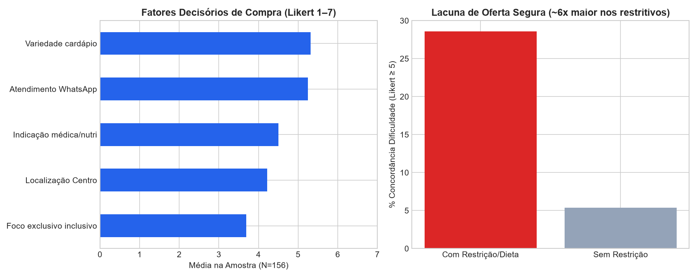
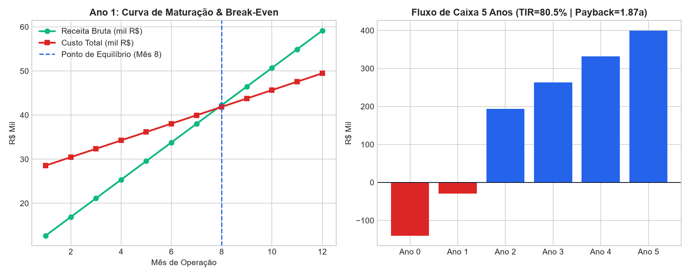

# TCC Aprovado (UFJF): Viabilidade Econômico-Financeira & Pesquisa de Mercado (N=156) — Startup Nourish


-0f766e?style=flat)


Trabalho de Conclusão de Curso (**Bacharelado em Administração — UFJF**, apresentado e aprovado em **12/11/2026**) avaliando a viabilidade mercadológica, operacional (cozinha unidirecional RDC 216 ANVISA + rastreabilidade por QR Code) e econômico-financeira de uma *startup* de alimentação saudável e *free-from*.

> **Privacidade:** Os dados do levantamento foram anonimizados (remoção de timestamps e texto livre identificável).

---

## Síntese Quantitativa & Financeira

* **Pesquisa de Mercado (`N = 156`):** `37,2%` possuem restrição alimentar/dieta específica; queixa de escassez **~6x superior** entre restritivos (`31,0%` vs `5,1%`); clareza nutricional como fator decisivo (`média 5,01/7,0`).
* **Investimento Inicial:** `R$ 140.000,00` (`R$ 55k` fixo + `R$ 25k` pré-op + `R$ 60k` capital de giro cobrindo integralmente o déficit de maturação dos meses 1–7).
* **Ponto de Equilíbrio:** Mês 8 (`50 refeições/dia`, faturamento `R$ 42.250,00` vs PE operacional `R$ 41.545,45/mês`).
* **Retorno em 5 Anos (TMA `12% a.a.`):** **VPL positivo (`~R$ 613 mil`)**, **TIR (`~80,5% a.a.`)** e **Payback Simples (`~1,87 anos`)**.

---

## Como Executar

```bash
pip install -r requirements.txt
python src/analisar_pesquisa.py
python src/viabilidade_financeira.py
```

## Amostras Visuais




---

**Autor:** [Jonathan Campos Cusandei](https://www.linkedin.com/in/jonathancusandei/) · [Portfólio Executivo](https://jonathancusandei-glitch.github.io/portfolio-jonathan/)
